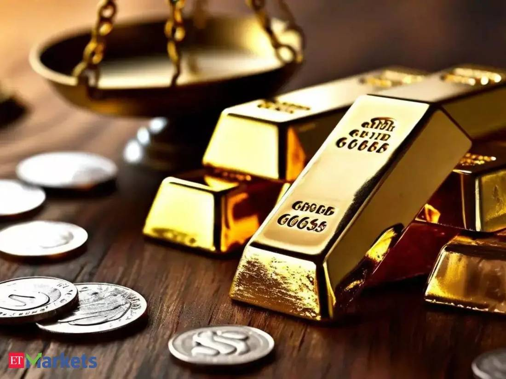
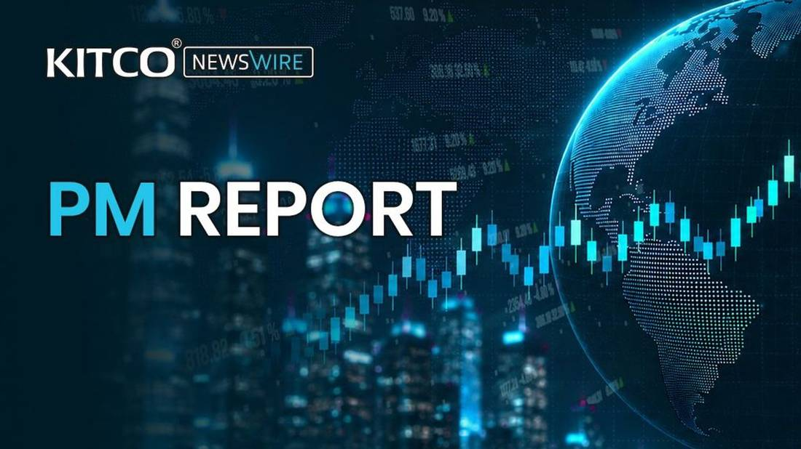

# Gold & Silver for Indian buyers · 2026-11-04T10:00Z

## Today's brief

**Gold tops $4,000 as Democrat sweep sinks the dollar**

Spot gold topped $4,000/oz as Democrats' sweep sank the dollar to a one-month low; MCX gold neared Rs 1.42 lakh/10 g.

- Morningstar says the dollar sank to a one-month low after AP called a Democratic Senate win; IANS says lower Treasury yields added support.

- On MCX, December gold and silver climbed about 2% and 3% on the weaker dollar, IANS reports, with traders eyeing Dhanteras buying on Nov 6.

- The US jobs report due Friday could reset December Fed-hike odds near 78%; Kitco says strong labour data has been pressuring bullion.

> Gold holds above $4,000 on Democrats' sweep; MCX gold nears Rs 1.42 lakh ahead of Dhanteras

Spot gold held above $4,000 an ounce as US midterm results confirmed a Democratic sweep of Congress and sank the dollar to a one-month low. On MCX, December gold rose 1.76% to Rs 1,41,911 per 10 g and December silver advanced 3.09% to Rs 1,85,249 per kg, while hot US jobs data kept December Fed-hike bets near 78% in the background.

- Spot gold held $4,000/oz (+~2%) on the Democratic sweep; dollar at a one-month low; MCX Dec gold +1.76% to Rs 1,41,911/10g and silver +3.09% (Kitco, IANS).

- US Sept job openings beat at 7.523m; CME FedWatch sees December hike odds near 78%, with the US jobs report due Friday (ETMarkets, Kitco).

- WGC halved 2026 gold investment growth forecast to 200t on slow bar-and-coin buying; Q3 central-bank buying jumped 42% to ~320t (IDNFinancials, InvestingLive).

- India's Q3 gold demand fell 29% to 162.5t; informal imports jumped 1,500%+ to 50t after the 15% duty hike, a three-year high (GJEPC, BusinessLine).

## Trending

- **Democratic sweep lifts gold above $4,000; MCX bullion rallies**: Spot gold topped $4,000, up ~2%, on confirmed Democratic-sweep results; the dollar sank to a one-month low and MCX Dec gold rose 1.76% to Rs 1,41,911/10g. (stories 1, 2, 4)

- **December Fed-hike bets near 78% after hot US jobs data**: Hot US jobs data kept December Fed-hike odds near 78%, pressuring bullion earlier in the day; the ETMarkets outlook weighs whether gold bounces back, with the US jobs report due Friday. (stories 3, 6, 5)

- **WGC halves 2026 investment forecast to 200t; central banks offset**: The World Gold Council cut its 2026 gold investment growth forecast to 200t on slower bar-and-coin buying, even as Q3 central-bank buying jumped 42% year-on-year to ~320t. (stories 10, 11, 12)

- **India's Q3 demand down 29%; grey-market imports at three-year high**: GJEPC says India's Q3 gold demand fell 29% on high prices while informal imports jumped after the duty hike; gold ETF inflows slowed as AMCs suspended fund-of-funds. (stories 7, 14, 16)

- **Dhanteras countdown: jeweller stocks rally on festive demand bets**: Two days before Dhanteras, Titan, PC Jeweller and Senco Gold rose on strong Q2 updates and rebounding bullion, even as GJEPC reports Q3 gold demand fell 29% on high prices. (stories 9, 7)

## Stories

### 1. Gold prices hit $4,000 as Democrats see electoral Sweep to gain control of Congress 

*Kitco* · 2026-11-04T06:06:41Z · [kitco.com](https://www.kitco.com/news/article/2026-11-04/gold-prices-hit-4000-democrats-see-electoral-sweep-gain-control-congress)

Spot gold tested $4,000/oz, up nearly 2%, as US midterm results showed Democrats poised to sweep Congress. Tastylive's Christopher Vecchio told Kitco a blue sweep could support bullion into 2027, while MarketGauge's Michele Schneider cautioned gold won't automatically benefit, warning a break below $3,940 could trigger fresh selling.

### 2. Gold, silver surge up to 3 pc over weaker US dollar, geopolitical uncertainty 

*IANS* · 2026-11-04T06:44:00Z · [ianslive.in](https://ianslive.in/gold-silver-surge-up-to-25-pc-over-weaker-us-dollar-geopolitical-uncertainty--20261104120932)

Gold and silver extended Wednesday's gains on a weaker dollar, lower yields and geopolitical uncertainty: MCX December gold rose 1.76% to Rs 1,41,911/10g and December silver advanced 3.09% to Rs 1,85,249/kg, recovering from an early-session slide, IANS reports. COMEX gold was $3,963.20/oz, silver $49.99/oz; traders still see a 78% chance of a December Fed hike.

Related: https://inshorts.com/en/amp_news/gold--silver-prices-jump-sharply-on-mcx-ahead-of-dhanteras-1793781981828

### 3. MCX gold prices at Rs 1.39 lakh/10 gram; silver tanks Rs 2,000/kg as US jobs data fuels rate hike bets. Key levels to track ahead of Dhanteras 

*The Economic Times* · 2026-11-04T04:12:00Z · [economictimes.indiatimes.com](https://economictimes.indiatimes.com/markets/commodities/news/mcx-gold-prices-at-rs-1-39-lakh/10-gram-silver-tanks-rs-2000/kg-as-us-jobs-data-fuels-rate-hike-bets/articleshow/135522437.cms)

MCX December silver futures fell Rs 2,000 to Rs 1,77,784 per kg in Wednesday's session while gold held near Rs 1.39 lakh per 10 g, as a strong US September jobs report lifted December Fed rate-hike bets to 78%, ETMarkets reports. Spot gold was at $3,948.75 and spot silver at $49.67.

### 4. EMEA Morning Briefing: Futures Fall, Dollar Weakens as Democrats Win Senate 

*Morningstar* · 2026-11-04T05:16:00Z · [morningstar.com](https://www.morningstar.com/news/dow-jones/20261104108/emea-morning-briefing-futures-fall-dollar-weakens-as-democrats-win-senate)

European stock futures fell and the US dollar sank to a one-month low on Wednesday after the Associated Press called a Democratic Senate majority in the US midterms, fuelling blue-sweep bets. Gold recovered after slipping to $3,900 as Treasury yields hit their lowest in nearly two months, though traders kept December Fed-hike odds near 78% ahead of Friday's non-farm payrolls.

### 5. Gold price prediction: Will gold bounce back on Wednesday? Check outlook for November 4 

*Economic Times* · 2026-11-04T02:27:00Z · [economictimes.indiatimes.com](https://economictimes.indiatimes.com/markets/commodities/news/gold-price-prediction-will-gold-bounce-back-on-wednesday-check-outlook-for-november-4/articleshow/135518967.cms)

Gold stays in focus Wednesday as softer oil eases inflation fears, with eyes on US midterm results, Dhanteras demand and US jobs data. Prithvi Finmart's Manoj Kumar Jain pegs support at $3,800/oz for gold and $45/oz for silver, with MCX gold near Rs 1.38 lakh support and Rs 1.40 lakh resistance. Bank of America expects gold under $4,000/oz for three months, averaging $4,000 in Q4.

### 6. Gold, silver decline as strong U.S. jobs data lifts yields on election day - Kitco PM Report 

*Kitco* · 2026-11-03T22:22:58Z · [kitco.com](https://www.kitco.com/news/article/2026-11-03/gold-silver-decline-strong-us-jobs-data-lifts-yields-election-day-kitco-pm)

Spot gold and silver fell in late US trading on Tuesday as stronger-than-expected US labor data — September job openings rose to 7.523m vs ~7.15m expected — lifted Treasury yields and reinforced bets on further Fed tightening, Kitco reports. Spot gold held near $3,924/oz (-0.55%); silver slid 2.1% to ~$49.45, with traders also positioning for the midterm results.

### 7. India's Gold Demand Falls 29% in Q3 as High Prices Restrain Buying 

*GJEPC* · 2026-11-03T11:23:00Z · [gjepc.org](https://gjepc.org/solitaire/indias-gold-demand-falls-29-in-q3-as-high-prices-restrain-buying/)

India's gold demand fell 29% year-on-year to 162.5 tonnes in Q3 2026 as record-high prices curbed buying, WGC said. Jewellery demand dropped 20% to 99.9 tonnes; bar and coin buying fell 40% to 55 tonnes. In value terms demand still rose 3% to ₹2.42 lakh crore on an average Q3 price of $4,262 an ounce (₹1,48,891 per 10g). WGC pegs 2026 full-year demand at 625–675 tonnes, a six-year low.

Related: https://www.7globe.in/indias-gold-demand-falls-29-in-q3-wgc-sees-2026-demand-at-six-year-low/

### 8. Silver prices crash ₹8,500/kg, gold drops ₹2,000/10g as US-Iran tensions revive inflation fears; is more fall ahead? 

*Mint* · 2026-11-03T10:32:00Z · [livemint.com](https://www.livemint.com/market/stock-market-news/silver-prices-crash-rs-8-500-kg-gold-drops-rs-2-000-10g-as-us-iran-tensions-revive-inflation-fears-is-more-fall-ahead-11793698796709.html)

December silver futures on MCX resumed their losing streak on Tuesday after reports of a US strike on Iran's Qeshm Island sent crude higher, reviving inflation fears and rate-hike expectations. Silver futures slipped ₹8,528 per kg to their lowest since late November 2025, while gold fell ₹2,000 per 10 grams, erasing Monday's brief rebound.

### 9. Dhanteras 2026: How Titan, PC Jeweller, Senco Gold stocks are shaping up ahead of the big day 

*Upstox* · 2026-11-04T05:15:49Z · [upstox.com](https://upstox.com/news/market-news/stocks/dhanteras-2026-how-titan-pc-jeweller-senco-gold-stocks-are-shaping-up-ahead-of-the-big-day/article-202943/)

Jewellery stocks traded higher in Wednesday morning trade ahead of Dhanteras on November 6: Titan was up over 1% at Rs 4,612.40, PC Jeweller rose nearly 3% to Rs 15.12 and Senco Gold added 1.42%. The piece cites strong September-quarter business updates and management commentary pointing to a healthy festive and wedding-season demand outlook.

Related: https://www.livemint.com/market/stock-market-news/us-midterm-elections-kalyan-jewellers-pc-lalithaa-to-senco-top-jewellery-stock-to-buy-as-gold-silver-rates-rebound-11793764057589.html

### 10. WGC cuts 2026 gold investment growth forecast 

*IDNFinancials* · 2026-11-04T03:40:00Z · [idnfinancials.com](https://www.idnfinancials.com/news/71238/wgc-cuts-2026-gold-investment-growth-forecast)

The World Gold Council halved its 2026 gold investment demand growth forecast to 200 tonnes from 400 tonnes on sharply slower bar-and-coin buying, though it raised its central-bank buying forecast. Q3 gold ETF inflows were 211 tonnes; spot hit a one-year low last Friday, down 29% from January's $5,595 record (Reuters).

### 11. Central bank gold buying jumps 42% in Q3 as high prices hit jewellery demand, WGC says 

*InvestingLive* · 2026-11-03T23:06:01Z · [investinglive.com](https://investinglive.com/commodities/central-bank-gold-buying-jumps-42-in-q3-as-high-prices-hit-jewellery-demand-wgc-says/)

Central banks bought ~320 tonnes in Q3, up 42% on the year and ~675t so far in 2026, the WGC said — offsetting a 17% slump in jewellery consumption to ~310t, the weakest Q3 in the series, and a 19% fall in bar and coin demand. Gold averaged ~$4,260/oz; total demand was ~1,370t (-1%), with YTD demand level with 2025’s record.

Related: https://www.gold.org/news-and-events/press-releases/central-bank-buying-and-etf-inflows-support-gold-demand-q3

### 12. Gold (XAUUSD), Silver, Platinum Forecasts – Gold Pulls Back As Selling Resumes

*FXEmpire* · 2026-11-03T18:05:20Z · [fxempire.com](https://www.fxempire.com/forecasts/article/gold-xauusd-silver-platinum-forecasts-gold-pulls-back-as-selling-resumes-1642282)

Gold slipped again on Tuesday as rising Treasury yields — the 2-year above 4.61% and the 10-year above 4.95% — and near-77% December Fed-hike bets outweighed the pullback in oil prices ahead of the US midterm vote, FXEmpire reports. Spot gold was testing the $3,890–$3,910 support zone, while silver slid back toward $50 as the gold-silver ratio climbed above 79.

Related: https://www.fxempire.com/forecasts/article/gold-xau-usd-price-forecast-critical-support-holds-amid-growing-downside-risk-1642355

### 13. ROI-As markets sway, safe havens shine. Except gold: McGeever 

*Mint* · 2026-11-03T23:31:29Z · [livemint.com](https://www.livemint.com/market/roias-markets-sway-safe-havens-shine-except-gold-mcgeever-11793748689717.html)

Reuters’ Jamie McGeever argues gold, “the oldest safety play of all,” has failed to find a bid despite a risk-off backdrop reviving Treasuries, the dollar, franc and yen: gold is below $4,000/oz, down 9% YTD and ~10% under its 200-day average. An IMF paper found bullion is not a “reliable” hedge against equity volatility; central-bank buying (+42% in Q3 to 321t) is the bright spot.

### 14. India's tax hike drives illegal gold imports to 3-year high

*The Hindu BusinessLine* · 2026-11-03T07:26:00Z · [thehindubusinessline.com](https://www.thehindubusinessline.com/markets/gold/indias-tax-hike-drives-illegal-gold-imports-to-3-year-high/article71659744.ece)

The World Gold Council says India's informal gold imports surged more than 1,500% to 50 tonnes in the September quarter, from 3 tonnes a year earlier, the highest since 2023, citing Metals Focus data. The grey market has flourished since May's duty hike to 15%, and jewellers are holding back on restocking ahead of Diwali while more households buy for cash without invoices.

Related: https://inshorts.com/en/news/india-s-illegal-gold-imports-jump-1-500--after-duty-hike-1793697860513

### 15. MCX Q2 profit jumps over two-fold to ₹455 crore as trading volumes surge

*The Hindu BusinessLine* · 2026-11-04T03:54:21Z · [thehindubusinessline.com](https://www.thehindubusinessline.com/markets/commodities/mcx-q2-profit-jumps-over-two-fold-to-455-crore-as-trading-volumes-surge/article71663889.ece)

MCX's Q2 FY27 net profit more than doubled to ₹455 crore from ₹197 crore a year ago, with total income rising to ₹800 crore on record trading volumes. Futures average daily turnover rose to ₹62,819 crore; the exchange handled physical delivery of 5.68 tonnes of gold and 199.91 tonnes of silver during the quarter.

### 16. Gold ETF inflows slow to ₹3,300 crore in October as AMCs suspend FoFs 

*Business Standard* · 2026-11-03T13:37:00Z · [business-standard.com](https://www.business-standard.com/markets/news/gold-etf-inflows-slow-to-3-300-crore-in-october-as-amcs-suspend-fofs-126110301655_1.html)

Gold ETFs drew an estimated ₹3,300 crore in October, down from September’s seven-month high of ₹4,450 crore, as most AMCs suspended fresh subscriptions to gold fund of funds in the second half of October following a Sebi direction linked to rising gold imports and rupee pressure. Analysts quoted say gold stays under pressure from Fed rate-hike expectations, a strong dollar and rising bond yields.

### 17. Rupee extends gains for third day, settles at 94.75 against the dollar 

*Business Standard* · 2026-11-03T13:56:00Z · [business-standard.com](https://www.business-standard.com/markets/news/rupee-extends-gains-for-third-day-settles-at-94-75-against-the-dollar-126110301693_1.html)

The rupee strengthened for a third straight session, settling at 94.75 per dollar after opening at 94.68 versus a 94.90 previous close, supported by foreign fund inflows into domestic equities. Gains were capped by rebounding crude — Brent rallied to $106.07 a barrel after a US attack on Iran — and the currency has gained 1.14% so far this quarter on regulatory measures.

---
*Window 2026-11-04T09:00:00Z → 2026-11-04T10:00:00Z · generated 2026-11-04T10:04:48Z*
