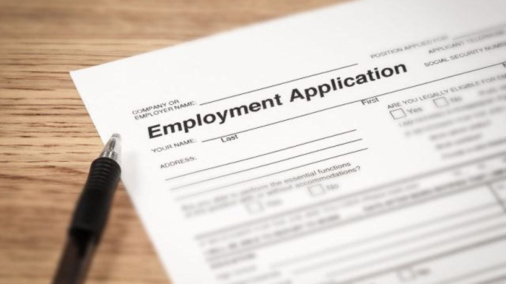
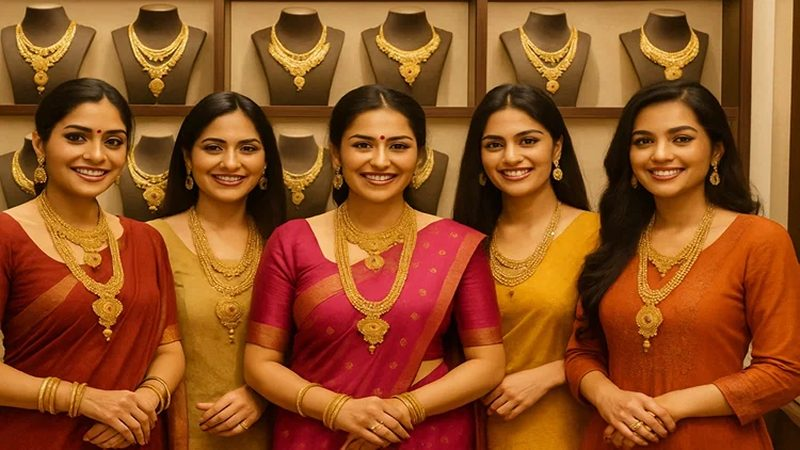
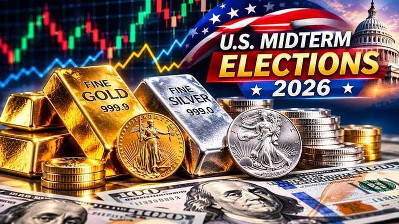
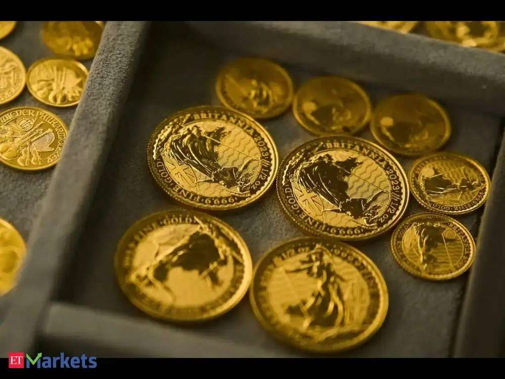
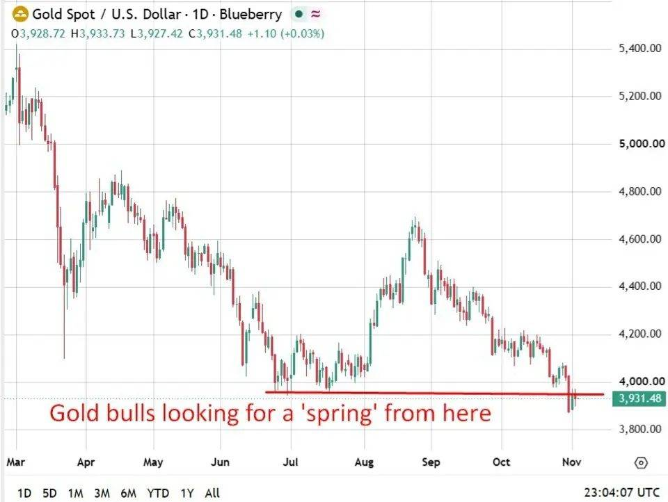
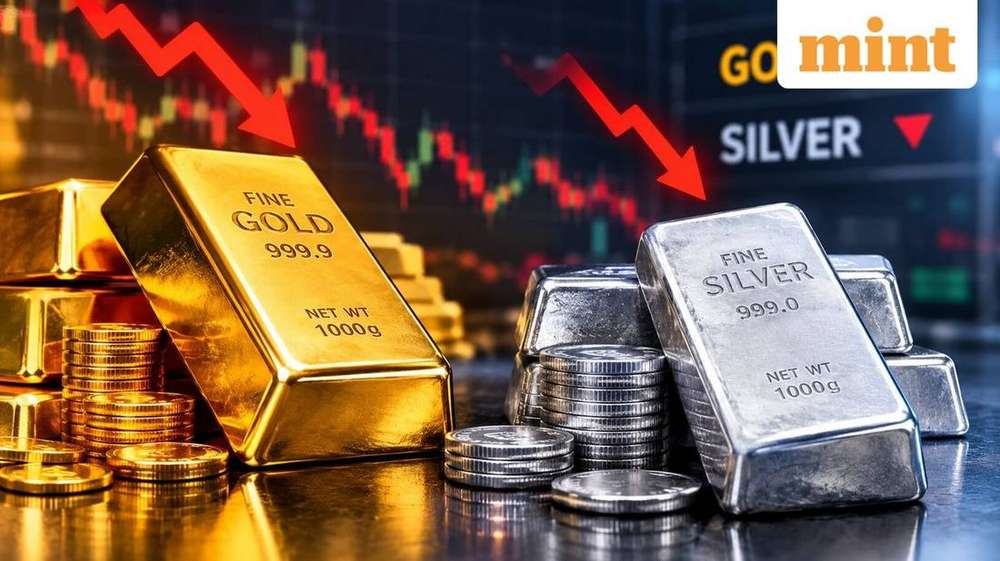
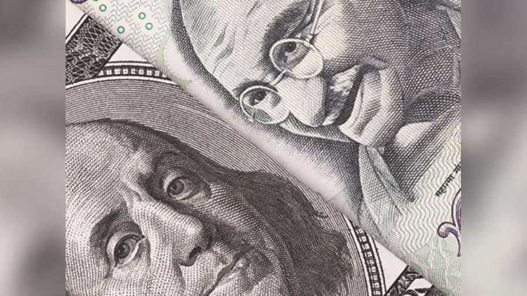

# Gold & Silver for Indian buyers · 2026-11-04T18:00Z

## Today's brief
**Gold stays above $4,000 as ADP jobs beat keeps Fed bets up**
Spot gold stayed near $4,038/oz, up ~2%, as ADP payrolls beat forecasts; MCX gold hovered near Rs 1.42 lakh/10 g.
- Kitco says bullion took the hot ADP print in stride; the Democrats' sweep kept the dollar near a one-month low, aiding gold and silver.
- The rupee's third straight gain cushioned the MCX move against spot; jewellers stay upbeat on Dhanteras demand with the festival on Nov 6.
- The US jobs report lands Friday at 7 PM IST; Kitco says another strong labour print could bring fresh pressure on gold.

> Gold stays above $4,000; Delhi gold rises to Rs 1.46 lakh/10 g ahead of Dhanteras

Spot gold held above $4,000 an ounce on Wednesday, up about 3% at $4,043.93, as the Democrats' midterm sweep kept the dollar weak. In Delhi, gold of 99.9% purity rose Rs 4,800 to Rs 1,46,600 per 10 g and silver jumped Rs 9,000 to Rs 1.93 lakh per kg, two days before Dhanteras, the All India Sarafa Association said.

- Spot gold topped $4,043/oz (+3%) as ADP payrolls beat forecasts (86K vs 67K); the Democrats' sweep sank the dollar to a one-month low (Kitco).

- Delhi gold +Rs 4,800/10g to Rs 1,46,600, silver +Rs 9,000/kg to Rs 1.93 lakh on festive buying; MCX Dec gold +2.42% to Rs 1,42,820 (Sarafa Association).

- Jewellers expect strong Dhanteras sales on lightweight pieces after gold's 12% correction; volumes flat, value up ~30% (GJC/PTI).

- WGC halved 2026 gold investment growth forecast to 200t on weak bar-and-coin buying; Q3 central-bank buying jumped 42% to ~320t (WGC).

## Trending

- **Gold tops $4,000 as Democrats sweep Congress; ADP jobs beat adds fuel**: Spot gold pushed to $4,043.93/oz, up 3%, as the Democrats' sweep sank the dollar and ADP payrolls beat forecasts; Delhi gold rose Rs 4,800 to Rs 1,46,600/10g two days before Dhanteras. (stories 1, 5, 2, 7)

- **MCX day session: gold +2.4%, silver +4.3% on weaker dollar**: MCX December gold rose 2.42% to Rs 1,42,820/10g and silver jumped 4.28% to Rs 1,87,397/kg at 3:50 PM IST; IANS put the metals up to 3% on a weaker dollar and lower yields. (stories 3, 6, 8)

- **Dhanteras countdown: jewellers expect strong sales on lighter pieces**: Jewellers are upbeat on Dhanteras (Nov 6) sales after gold's 12% correction, GJC's Rajesh Rokde told PTI, with lightweight jewellery and silver coins in demand; volumes flat, value up ~30%. (stories 4, 16, 17)

- **Silver outruns gold on the rebound after Tuesday's crash**: Silver surged Rs 9,000/kg to Rs 1.93 lakh in Delhi and jumped over 4% on MCX to Rs 1,87,397/kg, recovering from Tuesday's Rs 8,528/kg crash. (stories 2, 6, 12)

- **WGC halves 2026 investment forecast; India demand cools 29%**: The WGC cut 2026 gold investment growth to 200t on weak bar-and-coin buying, though Q3 central-bank buying jumped 42% to ~320t; India's Q3 demand fell 29% to 162.5t as grey imports hit a 3-year high. (stories 9, 10, 11, 13)

## Stories

### 1. Gold prices holding $4,000 as ADP says US economy created 86k jobs in October 

*Kitco* · 2026-11-04T13:15:45Z · [kitco.com](https://www.kitco.com/news/article/2026-11-04/gold-prices-holding-4000-adp-says-us-economy-created-86k-jobs-october)

Spot gold stayed above $4,000 an ounce, up more than 2% at $4,037.70, taking October's stronger-than-expected ADP report - 86,000 new jobs versus 67,000 expected - in stride. Kitco notes the rally was driven overnight by the Democrats' midterm sweep of Congress, while the healthy labour print could bring renewed selling pressure ahead of Friday's US payrolls report.

### 2. Gold climbs Rs 4,800 to Rs 1.46 lakh/10 gm in Delhi; silver surges Rs 9,000 

*Amar Ujala Bonus* · 2026-11-04T13:49:00Z · [amarujalabonus.com](https://www.amarujalabonus.com/commodity/gold-price-today-gold-jumps-rs-4-800-to-rs-1-46-lakh-in-delhi-silver-surges)

Delhi bullion rebounded two days before Dhanteras: gold of 99.9% purity rose Rs 4,800 to Rs 1,46,600 per 10 g and silver jumped Rs 9,000 to Rs 1.93 lakh per kg, inclusive of taxes, the All India Sarafa Association said. Spot gold climbed 3% to $4,043.93 an ounce, back above $4,000, with HDFC Securities' Saumil Gandhi citing the strong global recovery and improving festive demand.

### 3. US Midterm Elections Jewellery Stocks, Gold and Silver Rates 

*Univest* · 2026-11-04T11:46:10Z · [univest.in](https://univest.in/blogs/us-midterm-elections-jewellery-stocks-gold-and-silver-rates-watchlist)

MCX December gold rose 2.42% to Rs 1,42,820 per 10 g and silver jumped 4.28% to Rs 1,87,397 per kg as of 3:50 PM IST, as the dollar slid on US midterms showing a Democratic sweep of Congress. Jewellery stocks rallied with the metals — Sky Gold up 6.5%, Titan 4.2%, Kalyan 4.1% — while Thangamayil fell 5.5%. Univest cites WGC data showing gold rose in 62% of six-month windows after past midterms.

### 4. Why Jewellers Expect Strong Dhanteras Sales Amid Recent Gold Price Drop 

*Daily Jagran* · 2026-11-04T13:22:00Z · [thedailyjagran.com](https://www.thedailyjagran.com/lite/business/news/why-jewellers-expect-strong-dhanteras-sales-amid-recent-gold-price-drop-10335167)

Jewellers are upbeat on Dhanteras sales on November 6 after gold's 12% price correction lifted sentiment, GJC chairman Rajesh Rokde told PTI. Demand is shifting to lightweight jewellery and small-ticket purchases, while silver coins gain traction with a 10% volume rise expected. Sales volumes should stay flat, but in value terms the industry expects about 30% growth.

### 5. Gold prices hit $4,000 as Democrats see electoral Sweep to gain control of Congress 

*Kitco* · 2026-11-04T06:06:41Z · [kitco.com](https://www.kitco.com/news/article/2026-11-04/gold-prices-hit-4000-democrats-see-electoral-sweep-gain-control-congress)

Spot gold tested $4,000/oz, up nearly 2%, as US midterm results showed Democrats poised to sweep Congress. Tastylive's Christopher Vecchio told Kitco a blue sweep could support bullion into 2027, while MarketGauge's Michele Schneider cautioned gold won't automatically benefit, warning a break below $3,940 could trigger fresh selling.

Related: https://economictimes.indiatimes.com/markets/us-stocks/news/gold-gains-3-as-dollar-slides-after-democratic-midterm-gains/articleshow/135543824.cms

### 6. Gold, silver surge up to 3 pc over weaker US dollar, geopolitical uncertainty 

*IANS* · 2026-11-04T06:44:00Z · [ianslive.in](https://ianslive.in/gold-silver-surge-up-to-25-pc-over-weaker-us-dollar-geopolitical-uncertainty--20261104120932)

Gold and silver extended Wednesday's gains on a weaker dollar, lower yields and geopolitical uncertainty: MCX December gold rose 1.76% to Rs 1,41,911/10g and December silver advanced 3.09% to Rs 1,85,249/kg, recovering from an early-session slide, IANS reports. COMEX gold was $3,963.20/oz, silver $49.99/oz; traders still see a 78% chance of a December Fed hike.

Related: https://inshorts.com/en/amp_news/gold--silver-prices-jump-sharply-on-mcx-ahead-of-dhanteras-1793781981828

### 7. EMEA Morning Briefing: Futures Fall, Dollar Weakens as Democrats Win Senate 

*Morningstar* · 2026-11-04T05:16:00Z · [morningstar.com](https://www.morningstar.com/news/dow-jones/20261104108/emea-morning-briefing-futures-fall-dollar-weakens-as-democrats-win-senate)

European stock futures fell and the US dollar sank to a one-month low on Wednesday after the Associated Press called a Democratic Senate majority in the US midterms, fuelling blue-sweep bets. Gold recovered after slipping to $3,900 as Treasury yields hit their lowest in nearly two months, though traders kept December Fed-hike odds near 78% ahead of Friday's non-farm payrolls.

### 8. Gold price prediction: Will gold bounce back on Wednesday? Check outlook for November 4 

*Economic Times* · 2026-11-04T02:27:00Z · [economictimes.indiatimes.com](https://economictimes.indiatimes.com/markets/commodities/news/gold-price-prediction-will-gold-bounce-back-on-wednesday-check-outlook-for-november-4/articleshow/135518967.cms)

Gold stays in focus Wednesday as softer oil eases inflation fears, with eyes on US midterm results, Dhanteras demand and US jobs data. Prithvi Finmart's Manoj Kumar Jain pegs support at $3,800/oz for gold and $45/oz for silver, with MCX gold near Rs 1.38 lakh support and Rs 1.40 lakh resistance. Bank of America expects gold under $4,000/oz for three months, averaging $4,000 in Q4.

### 9. WGC cuts 2026 gold investment growth forecast 

*IDNFinancials* · 2026-11-04T03:40:00Z · [idnfinancials.com](https://www.idnfinancials.com/news/71238/wgc-cuts-2026-gold-investment-growth-forecast)

The World Gold Council halved its 2026 gold investment demand growth forecast to 200 tonnes from 400 tonnes on sharply slower bar-and-coin buying, though it raised its central-bank buying forecast. Q3 gold ETF inflows were 211 tonnes; spot hit a one-year low last Friday, down 29% from January's $5,595 record (Reuters).

### 10. Central bank gold buying jumps 42% in Q3 as high prices hit jewellery demand, WGC says 

*InvestingLive* · 2026-11-03T23:06:01Z · [investinglive.com](https://investinglive.com/commodities/central-bank-gold-buying-jumps-42-in-q3-as-high-prices-hit-jewellery-demand-wgc-says/)

Central banks bought ~320 tonnes in Q3, up 42% on the year and ~675t so far in 2026, the WGC said — offsetting a 17% slump in jewellery consumption to ~310t, the weakest Q3 in the series, and a 19% fall in bar and coin demand. Gold averaged ~$4,260/oz; total demand was ~1,370t (-1%), with YTD demand level with 2025’s record.

Related: https://www.gold.org/news-and-events/press-releases/central-bank-buying-and-etf-inflows-support-gold-demand-q3

### 11. India's Gold Demand Falls 29% in Q3 as High Prices Restrain Buying 

*GJEPC* · 2026-11-03T11:23:00Z · [gjepc.org](https://gjepc.org/solitaire/indias-gold-demand-falls-29-in-q3-as-high-prices-restrain-buying/)

India's gold demand fell 29% year-on-year to 162.5 tonnes in Q3 2026 as record-high prices curbed buying, WGC said. Jewellery demand dropped 20% to 99.9 tonnes; bar and coin buying fell 40% to 55 tonnes. In value terms demand still rose 3% to ₹2.42 lakh crore on an average Q3 price of $4,262 an ounce (₹1,48,891 per 10g). WGC pegs 2026 full-year demand at 625–675 tonnes, a six-year low.

Related: https://www.7globe.in/indias-gold-demand-falls-29-in-q3-wgc-sees-2026-demand-at-six-year-low/

### 12. Silver prices crash ₹8,500/kg, gold drops ₹2,000/10g as US-Iran tensions revive inflation fears; is more fall ahead? 

*Mint* · 2026-11-03T10:32:00Z · [livemint.com](https://www.livemint.com/market/stock-market-news/silver-prices-crash-rs-8-500-kg-gold-drops-rs-2-000-10g-as-us-iran-tensions-revive-inflation-fears-is-more-fall-ahead-11793698796709.html)

December silver futures on MCX resumed their losing streak on Tuesday after reports of a US strike on Iran's Qeshm Island sent crude higher, reviving inflation fears and rate-hike expectations. Silver futures slipped ₹8,528 per kg to their lowest since late November 2025, while gold fell ₹2,000 per 10 grams, erasing Monday's brief rebound.

### 13. India's tax hike drives illegal gold imports to 3-year high

*The Hindu BusinessLine* · 2026-11-03T07:26:00Z · [thehindubusinessline.com](https://www.thehindubusinessline.com/markets/gold/indias-tax-hike-drives-illegal-gold-imports-to-3-year-high/article71659744.ece)

The World Gold Council says India's informal gold imports surged more than 1,500% to 50 tonnes in the September quarter, from 3 tonnes a year earlier, the highest since 2023, citing Metals Focus data. The grey market has flourished since May's duty hike to 15%, and jewellers are holding back on restocking ahead of Diwali while more households buy for cash without invoices.

Related: https://inshorts.com/en/news/india-s-illegal-gold-imports-jump-1-500--after-duty-hike-1793697860513

### 14. MCX Q2 profit jumps over two-fold to ₹455 crore as trading volumes surge

*The Hindu BusinessLine* · 2026-11-04T03:54:21Z · [thehindubusinessline.com](https://www.thehindubusinessline.com/markets/commodities/mcx-q2-profit-jumps-over-two-fold-to-455-crore-as-trading-volumes-surge/article71663889.ece)

MCX's Q2 FY27 net profit more than doubled to ₹455 crore from ₹197 crore a year ago, with total income rising to ₹800 crore on record trading volumes. Futures average daily turnover rose to ₹62,819 crore; the exchange handled physical delivery of 5.68 tonnes of gold and 199.91 tonnes of silver during the quarter.

### 15. Rupee extends gains for third day, settles at 94.75 against the dollar 

*Business Standard* · 2026-11-03T13:56:00Z · [business-standard.com](https://www.business-standard.com/markets/news/rupee-extends-gains-for-third-day-settles-at-94-75-against-the-dollar-126110301693_1.html)

The rupee strengthened for a third straight session, settling at 94.75 per dollar after opening at 94.68 versus a 94.90 previous close, supported by foreign fund inflows into domestic equities. Gains were capped by rebounding crude — Brent rallied to $106.07 a barrel after a US attack on Iran — and the currency has gained 1.14% so far this quarter on regulatory measures.

### 16. Dhanteras 2026: How Titan, PC Jeweller, Senco Gold stocks are shaping up ahead of the big day 

*Upstox* · 2026-11-04T05:15:49Z · [upstox.com](https://upstox.com/news/market-news/stocks/dhanteras-2026-how-titan-pc-jeweller-senco-gold-stocks-are-shaping-up-ahead-of-the-big-day/article-202943/)

Jewellery stocks traded higher in Wednesday morning trade ahead of Dhanteras on November 6: Titan was up over 1% at Rs 4,612.40, PC Jeweller rose nearly 3% to Rs 15.12 and Senco Gold added 1.42%. The piece cites strong September-quarter business updates and management commentary pointing to a healthy festive and wedding-season demand outlook.

Related: https://www.livemint.com/market/stock-market-news/us-midterm-elections-kalyan-jewellers-pc-lalithaa-to-senco-top-jewellery-stock-to-buy-as-gold-silver-rates-rebound-11793764057589.html

### 17. Buying gold this Dhanteras? 6 extra charges that could increase your jewellery bill 

*Upstox* · 2026-11-04T07:25:31Z · [upstox.com](https://upstox.com/news/personal-finance/commodities/buying-gold-this-dhanteras-6-extra-charges-that-could-increase-your-jewellery-bill/article-202957/)

Two days before Dhanteras, Upstox lists six charges buyers should watch beyond the quoted gold rate: making charges, wastage, 3% GST, the BIS hallmarking fee raised to Rs 75 per article in September 2026, stone charges on studded pieces, and buy-back deductions generally not recovered on resale.

### 18. New Samvat brings opportunities in mutual funds, equities and gold: Experts

*Business Standard* · 2026-11-04T14:31:29Z · [business-standard.com](https://www.business-standard.com/markets/news/new-samvat-brings-opportunities-in-mutual-funds-equities-and-gold-experts-126110401842_1.html)

Experts at Business Standard Hindi's Samvat webinar said India's long-term growth story stays strong, with investment opportunities across mutual funds, equities and gold, advising investors to keep a balanced portfolio as the new Samvat year begins.
